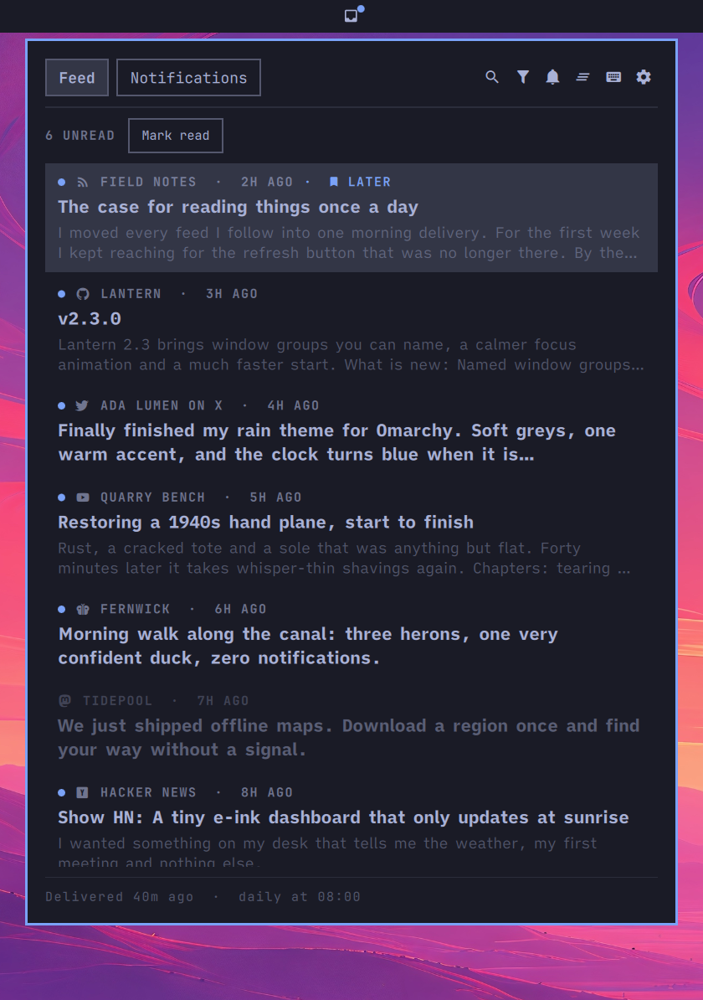
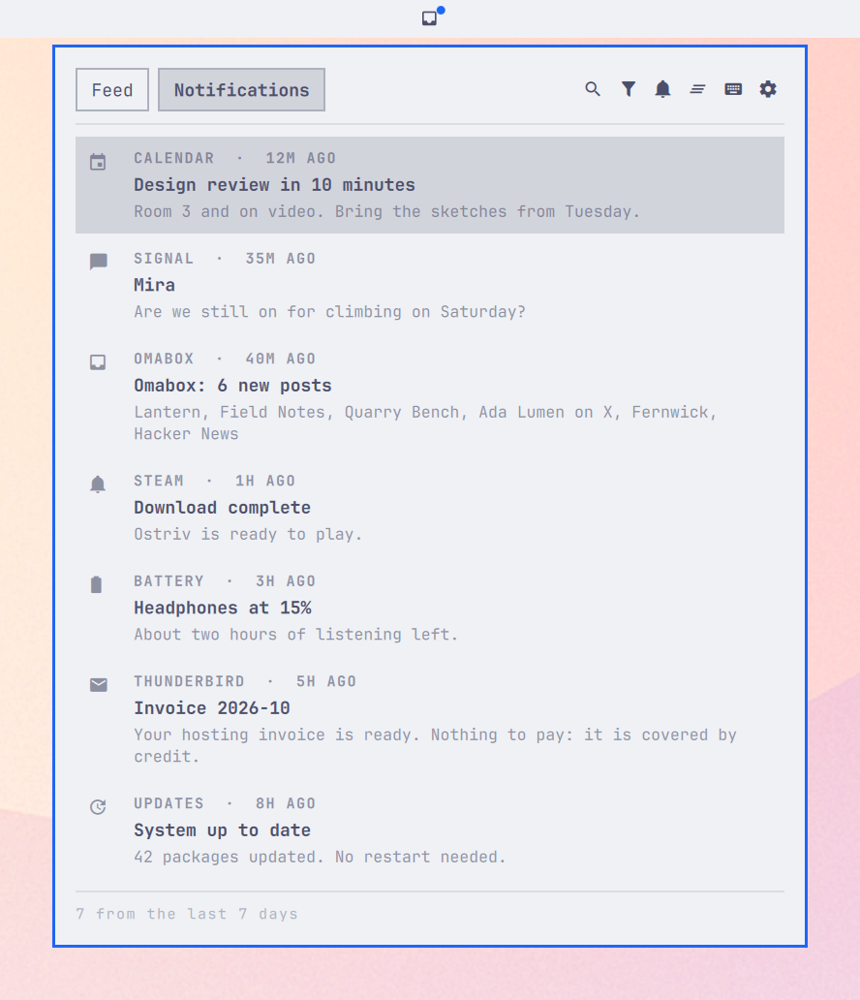
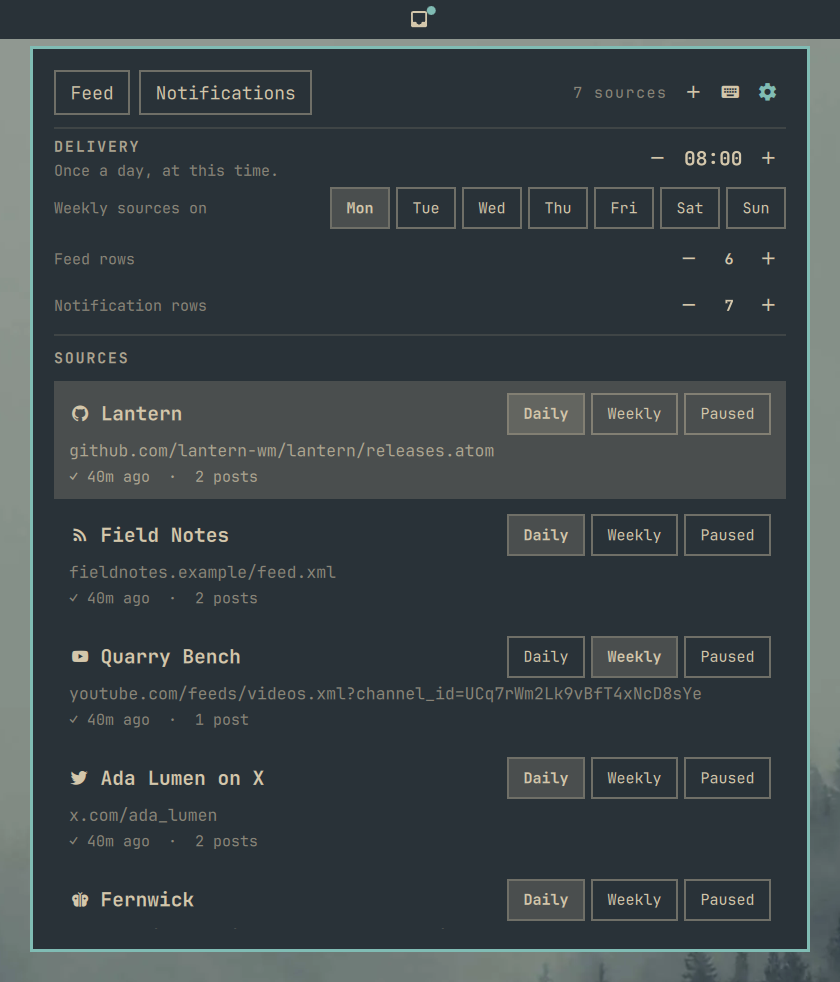
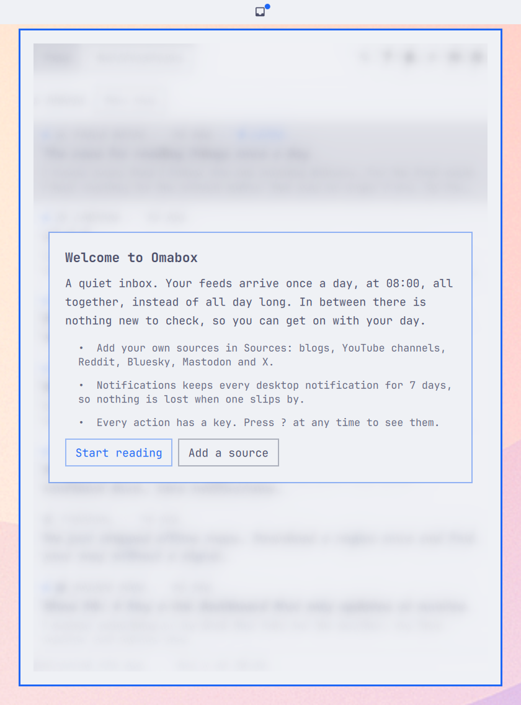
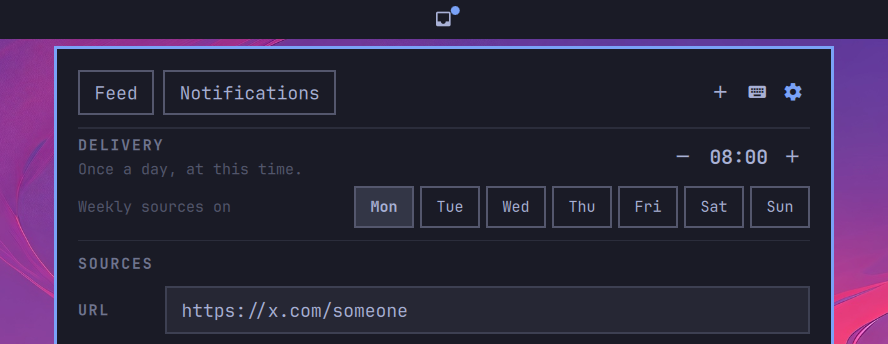
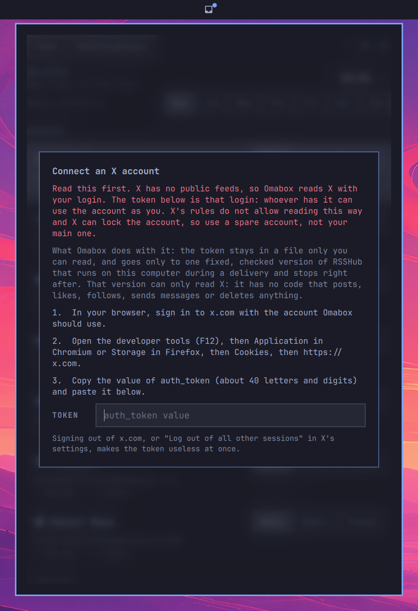

# Omabox

Omabox is a quiet inbox for the [Omarchy](https://omarchy.org) bar. It delivers your feeds once a day, at a time
you choose, instead of all day long. It also keeps a 7-day history of your desktop notifications. Both live in
one panel behind one bar icon.

It shows no likes, views or repost counts anywhere, so you read posts for what they say.

<p align="center">
  
  
  
</p>
<p align="center"><b>Feed</b> · <b>Notifications</b> · <b>Sources</b></p>

Omabox follows your Omarchy theme; these show Tokyo Night, Catppuccin Latte and Everforest. Every post,
source and notification in the screenshots is made up.

## Why once a day

Omabox is built to be distraction-free. Most feed readers refresh all day long and show a count that keeps
climbing, so you keep checking them. Omabox collects new posts quietly and hands them over at most once a day,
at the time you choose, like a morning paper. Between deliveries nothing new arrives, so there is nothing to
check.

This is on purpose, so Omabox has no mode that shows posts the moment they are published. Instead you can:

- pick the delivery time, for example 18:00 for an evening read (`-`/`+` in the Sources view),
- set busy sources to weekly, or pause them,
- fetch everything right now with `omabox fetch --all` when you really need to.

If you want every post as soon as it appears, a regular feed reader will suit you better.

## Features

- **Once-a-day delivery.** New posts arrive at your delivery time (08:00 by default), with one notification
  that names the sources. Sources can also be weekly or paused. A delivery missed while the computer was off
  or asleep comes as soon as it is back.
- **Many kinds of sources.** Any RSS or Atom feed, plus web pages with a feed link, GitHub releases, YouTube
  channels, Bluesky, Mastodon, Reddit, Hacker News and, optionally, X profiles. Paste a page address and
  Omabox finds the feed.
- **A reader.** Posts open in the panel with pictures, link previews and videos (played in your video
  player; YouTube, Reddit and Bluesky videos in `mpv`). Feeds that only send a summary can fetch the whole
  article, and posts that are only a link fetch it by themselves. Posts from X, Reddit, Hacker News, Bluesky
  and Mastodon show their comments under them.
- **Calm tools.** Snooze a post until later or tomorrow, keep a read-later list, mute words or patterns per
  source, search everything, and mark old posts read in one step.
- **Notification history.** Omarchy keeps its last 10 notifications; Omabox keeps every one for 7 days, with
  search, filters and do-not-disturb.
- **Keyboard first.** Every action has a key. Press `?` in the panel to show them.

## Requirements

- Omarchy with the plugin shell
- Python 3.11 or newer as `python3` (Omarchy ships it)

Optional:

- a video player and a picture viewer: Omabox opens your default ones, else `mpv` and `imv` (both come
  with Omarchy). YouTube, Reddit and Bluesky videos always play in `mpv`, YouTube through `yt-dlp` (also
  part of Omarchy).
- `wl-copy` to copy links
- `podman` or `docker` for X sources (see [X sources](#x-sources))

## Install

```sh
omarchy plugin add https://github.com/wienieclaurowy/omabox.git --enable
```

The icon appears in the bar. The first time you open it, a short welcome explains how it works. The first
delivery starts within a minute and brings two starter sources: Omarchy's releases and DHH's blog. Remove them
or add your own in the panel's Sources view.

<p align="center"></p>

To open the panel from a key, add a line like this to `~/.config/hypr/bindings.lua`, with any free key:

```lua
o.bind("SUPER + SHIFT + I", "Omabox", "omarchy-shell shell toggle io.github.wienieclaurowy.omabox")
```

### The `omabox` command

Most of what the panel does can also be done from a terminal with the `omabox` command, which ships with the
plugin. To put it on your `PATH`:

```sh
ln -s ~/.config/omarchy/plugins/io.github.wienieclaurowy.omabox/bin/omabox ~/.local/bin/omabox
```

A few things are only in the command:

- `omabox pause 3d` holds deliveries for a while (`omabox pause off` resumes them).
- `omabox opml export` and `omabox opml import FILE` move your sources from or to another reader.
- `omabox pick` searches your posts from the Omarchy menu. See [docs/launcher.md](docs/launcher.md).
- `omabox doctor` checks the setup and lists any feeds that failed.

Run `omabox --help` for the full list.

## Using it

Click the icon to open the feed. Middle-click it to mark everything read. A dot on the icon means unread posts.

The panel has three views: **Feed**, **Notifications** and **Sources** (keys `1`, `2`, `3`).

- In the feed, `j`/`k` move, `l` opens a post, `o` opens it in the browser, `z` snoozes it and `m` adds it
  to read later.
- In Sources, `n` adds a source, `c` changes its cadence, `m` sets mute words, `-`/`+` move the delivery
  time and `t` sets or replaces your X token.
- `?` shows every key for the view you are in.

### Settings

Set these in the widget's entry in `~/.config/omarchy/shell.json`:

| Setting | Default | What it does |
|---|---|---|
| `readingFont` | `iA Writer Quattro S` | Font for post text in the reader |
| `readingMeasure` | `70` | Reader line length, in characters (45 to 100) |
| `readerFontDelta` | `0` | Reader text size, relative to the theme (`+`/`-` in the reader change it) |
| `hints` | `false` | Show the key hints line (`?` toggles it) |

## X sources

X has no public feeds, so Omabox can only read X with an X login. It is optional: everything else works
without it.

> [!WARNING]
> **Your X token is your X login.** Whoever has it can use that account as you, until you sign it out.
> Reading X this way also goes against X's rules, and X can lock or suspend an account for it.
> **Use a spare account, not your main one,** and only add a token if you accept that risk.

### What Omabox does to keep the token safe

Omabox reads X through [RSSHub](https://docs.rsshub.app), an open-source feed generator, run on your own
computer in a podman or docker container. To make that as safe as it can be:

- **Only one checked version runs.** Omabox pins the exact RSSHub build it was tested with. Its X code only
  reads: it has no code that posts, likes, reposts, follows, sends messages, changes settings or deletes
  anything, and it sends the token to x.com only. A new RSSHub version reaches you only in an Omabox release.
- **It runs only during a delivery.** The container starts when an X source is fetched and stops right after,
  also when you log out or shut down mid-fetch; one left behind by a crash is removed within minutes, and podman
  stops it on its own after 30 minutes.
  Between deliveries no program holds your token.
- **Nothing else can use it.** RSSHub listens on your own computer only, and every run gets a new random key
  that each request must carry, so other programs and web pages cannot use your logged-in session.
- **It is locked down.** The container cannot write to its files, runs without root rights or extra
  permissions, has capped memory, and does not load any outside files at start.
- **The token stays private.** It is kept in `~/.config/omabox/x-token`, readable by you alone, and passed to
  the container through a private file that is deleted at once. It never appears in a command line or in
  Omabox's own files.

To revoke it at any time, sign out of x.com in that browser, or use "Log out of all other sessions" in X's
settings. Press `t` in Sources to replace or remove the saved token.

### Adding an X account

1. In Sources, press `n` (or click `+`) and paste an X profile address, such as `https://x.com/someone`.

   

2. The first time, Omabox asks for your X token. In your browser, sign in to x.com with the account Omabox
   should use. Open the developer tools (`F12`), then **Application** in Chromium-based browsers or **Storage**
   in Firefox, then **Cookies** and `https://x.com`. Copy the value of `auth_token`: about 40 letters and digits.

3. Paste it into the hidden **Token** field and press `Enter`. Omabox saves it and adds the profile.

   

The first X fetch downloads the RSSHub image (about a minute). If X later rejects the token, Omabox sends one
notification; press `t` in Sources to paste a new one. Omabox fetches each X source once per delivery, and
replies only when you open a post.

## Privacy

Omabox has no telemetry and no account. It talks only to the feeds you add, to the sites their posts link to
(for pictures, link previews and full articles), and, for X, to a local RSSHub container. Pictures, previews
and articles are never fetched from addresses on your local network, so a feed cannot use Omabox to reach your
router or other machines.

The notification history keeps the text of your notifications, which can include sign-in codes, for 7 days in
`~/.local/state/omabox/notifications`. `X` in the Notifications view clears it.

## Files

| Path | What is in it |
|---|---|
| `~/.config/omabox/sources.toml` | Your sources, written by the panel and the `omabox` command |
| `~/.config/omabox/x-token` | Your X token, if you use X sources |
| `~/.local/state/omabox/` | Posts, read state and the notification history |
| `~/.cache/omabox/` | Pictures and icons |

## Remove

```sh
omarchy plugin remove io.github.wienieclaurowy.omabox
rm -rf ~/.config/omabox ~/.local/state/omabox ~/.cache/omabox
rm -f ~/.local/bin/omabox
```

If you used X sources, also remove the RSSHub image, and sign the token out on x.com:

```sh
podman rmi $(podman images -q docker.io/diygod/rsshub)   # or the same with docker
```

## Development

Run the tests with `python -m unittest discover -s tests`. To work on a clone, link it as the plugin and
restart the shell after QML changes:

```sh
ln -sfn "$PWD" ~/.config/omarchy/plugins/io.github.wienieclaurowy.omabox
omarchy restart shell
```

The screenshots come from `python3 tools/screenshots/shots.py OUT-DIR feed:tokyo-night ...`, which shows the
real panel with invented data in a second, sandboxed Quickshell for a few seconds, without touching your own
shell, theme or Omabox data.

## License

[MIT](LICENSE)
